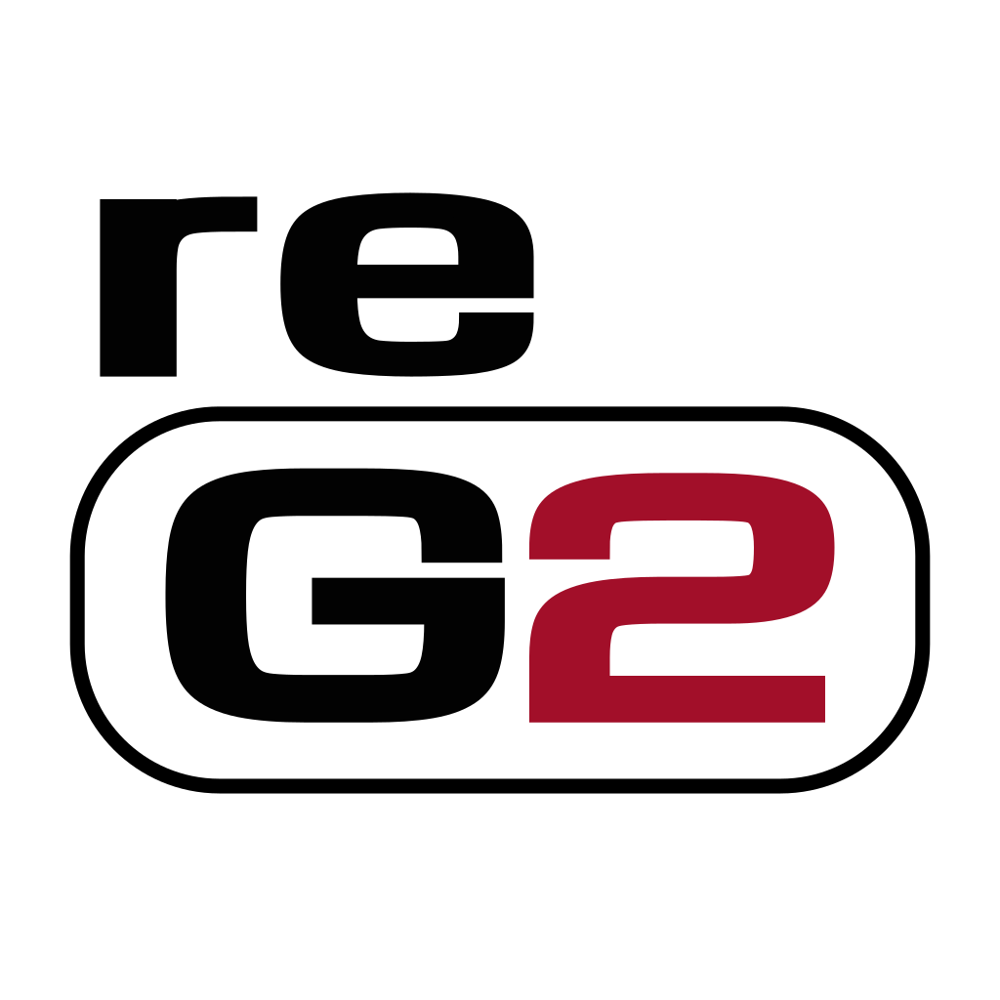
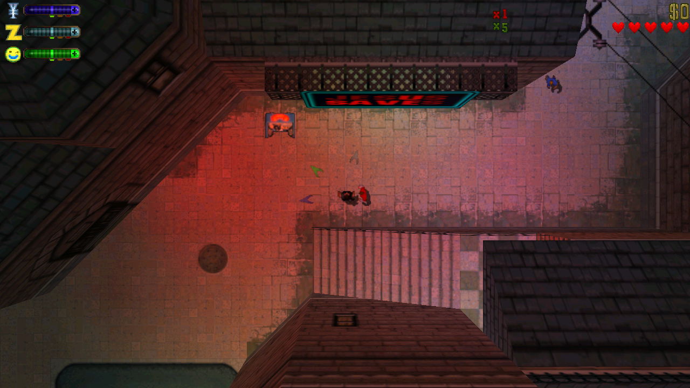
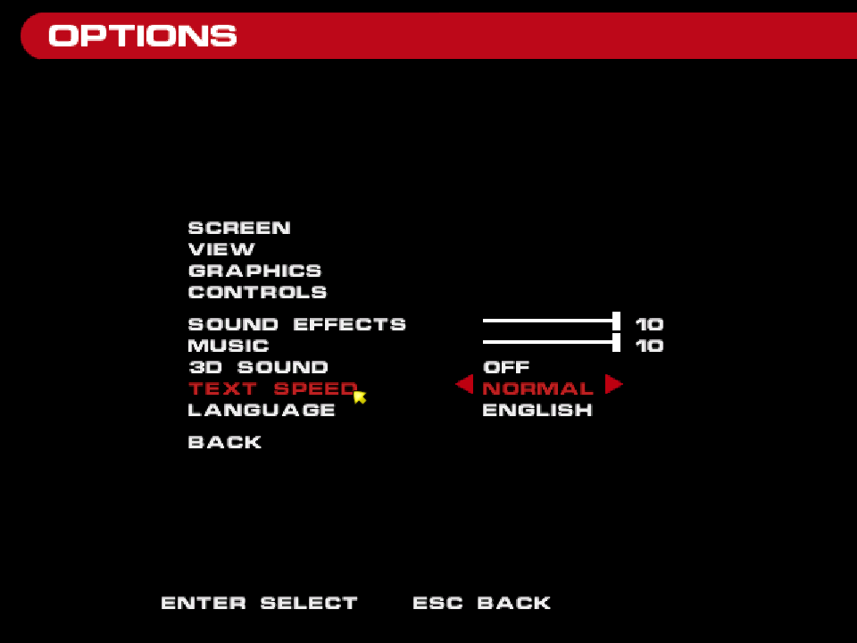
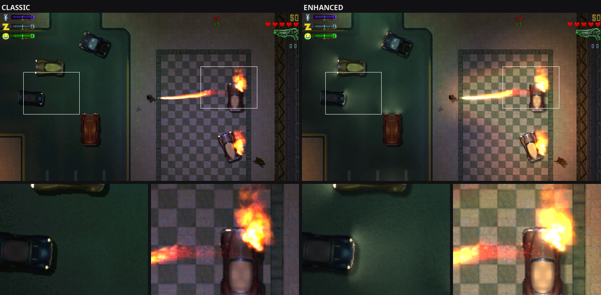
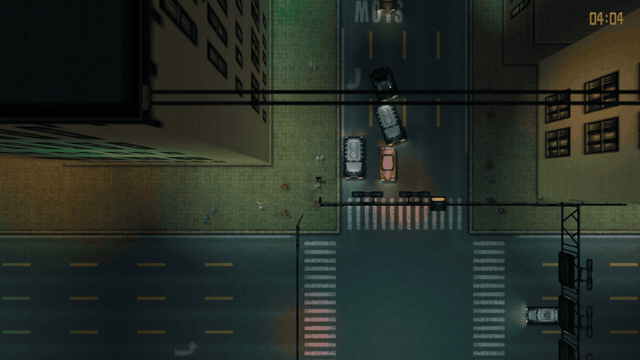
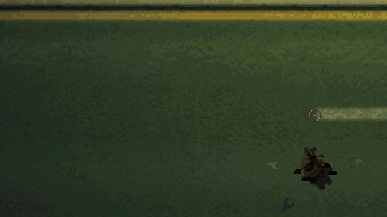

  <picture>
    <source media="(prefers-color-scheme: dark)" srcset="docs/images/reg2_logo_black.svg">
    
  </picture>

# reG2

Play GTA2 natively on Windows, Linux and macOS: the original game, rebuilt from its decompiled source,
with optional extras like smoother frame rates, better lighting and twin-stick controls.

> [!WARNING]
> **reG2 is a beta.** Expect bugs, and please report them. No multiplayer for now.

reG2 is a fork of [gta2_re](https://github.com/CriminalRETeam/gta2_re) by the CriminalRETeam, and all the
credit for the game itself goes to them: they rebuilt GTA2 (PC, version 10.5) function by function, in
C++ that compiles back to the original machine code. reG2 just adds what you need to run it today (SDL3,
OpenGL, sound, gamepads) and some extras on top.

You need your own copy of GTA2 for PC. The free 2004 release works.

## Same game by default

Out of the box it looks and plays like the original: same lighting, same controls, 30 fps. All the
extras below are off until you turn them on in OPTIONS (start menu, or Escape in game).

A few things differ anyway:

- it runs at your screen's resolution, and a wide screen shows a bit more on the sides
- the settings are in the game: OPTIONS in the start menu replaces GTA2 Manager, the original's separate
  settings program, and pressing Escape during a game pauses it and opens the same menu
- every menu works with the mouse, the keyboard or a gamepad
- no intro movie for now

## Extras

**Graphics.** GRAPHICS > PRESET switches between CLASSIC and ENHANCED: true colour, per-pixel lighting,
car headlights, light from gunfire, explosions and fires, soft shadows, bloom, anti-aliasing.

**Day and night.** SCREEN > LIGHTING > DAY-NIGHT CYCLE instead of the fixed dusk.

**Frame rate.** Up to 240 fps. The game still runs at its 30 steps per second and the frames in between
are interpolated, so it plays exactly the same, just smoother.

**Controls.** CONTROLS lets you change every key, in three columns: the original keys, a second set of
keys and the gamepad. The second set comes ready for keyboard and mouse: WASD to move, F to get in and
out of cars, left click to shoot, the wheel to change weapon. A gamepad works as soon as it's plugged in,
and in a car the triggers accelerate and brake progressively and the stick steers smoothly.

CONTROLS > TWIN STICK is a Hotline Miami style mode: move with one stick (or WASD), aim with the other
(or the mouse). Shots go where you aim, the camera leans toward the aim, and holding Shift (LT on a pad)
looks further. Roof guns on the fire truck, tank and gun jeep aim the same way.

**And also** 3D sound, camera zoom, HUD scale, a frame rate counter. The new menus follow the game's language, as far as your
copy of the game has it.

## Download

| System | Download |
|---|---|
|  Windows 10 or later | [reG2-windows-x64.zip](https://github.com/reG2-project/reG2/releases/latest/download/reG2-windows-x64.zip) |
|  Linux | [reG2-x86_64.AppImage](https://github.com/reG2-project/reG2/releases/latest/download/reG2-x86_64.AppImage), or [Flatpak](https://github.com/reG2-project/reG2/releases/latest/download/reG2-x86_64.flatpak), or [tar.gz](https://github.com/reG2-project/reG2/releases/latest/download/reG2-linux-x86_64.tar.gz) |
|  macOS (Apple Silicon) | [reG2-macos-arm64.dmg](https://github.com/reG2-project/reG2/releases/latest/download/reG2-macos-arm64.dmg) |
|  macOS (Intel) | [reG2-macos-x86_64.dmg](https://github.com/reG2-project/reG2/releases/latest/download/reG2-macos-x86_64.dmg) |
|  Nintendo 3DS (homebrew) | [reG2 3DS](https://github.com/reG2-project/reG2-3DS), its own repository |

All releases are on the [releases page](https://github.com/reG2-project/reG2/releases).

- **Windows:** unzip anywhere and run `reg2.exe`.
- **Linux:** the AppImage is the simplest: make it executable and run it. For the Flatpak,
  `flatpak install --user reG2-x86_64.flatpak` (needs Flathub set up). The tarball runs with `./reg2`.
  Nothing else to install: reG2 brings its own libraries and only uses the graphics, display and sound
  libraries every Linux desktop already has.
- **macOS:** untested, as I don't have a Mac: the builds come straight from GitHub's CI, so please tell
  me if it works. The app isn't signed by Apple, so the first time, right-click it and choose Open.

On first start reG2 asks for the game files: it can copy an existing GTA2 install, or install from the
free Rockstar Classics installer or the CD. Saves and settings go in your user folder.

## Building

See [`port/README.md`](port/README.md). The matching build from gta2_re (MSVC 6, `build.py`) still works
as before.

## Credits

- [gta2_re](https://github.com/CriminalRETeam/gta2_re) and everyone who worked on it.
- [SDL3](https://libsdl.org), [OpenAL Soft](https://openal-soft.org).
- The logo uses the [Michroma](https://github.com/googlefonts/Michroma-font) font (OFL).

Grand Theft Auto and GTA2 are trademarks of Take-Two Interactive. Not affiliated with Rockstar Games or
Take-Two. No game data included.
